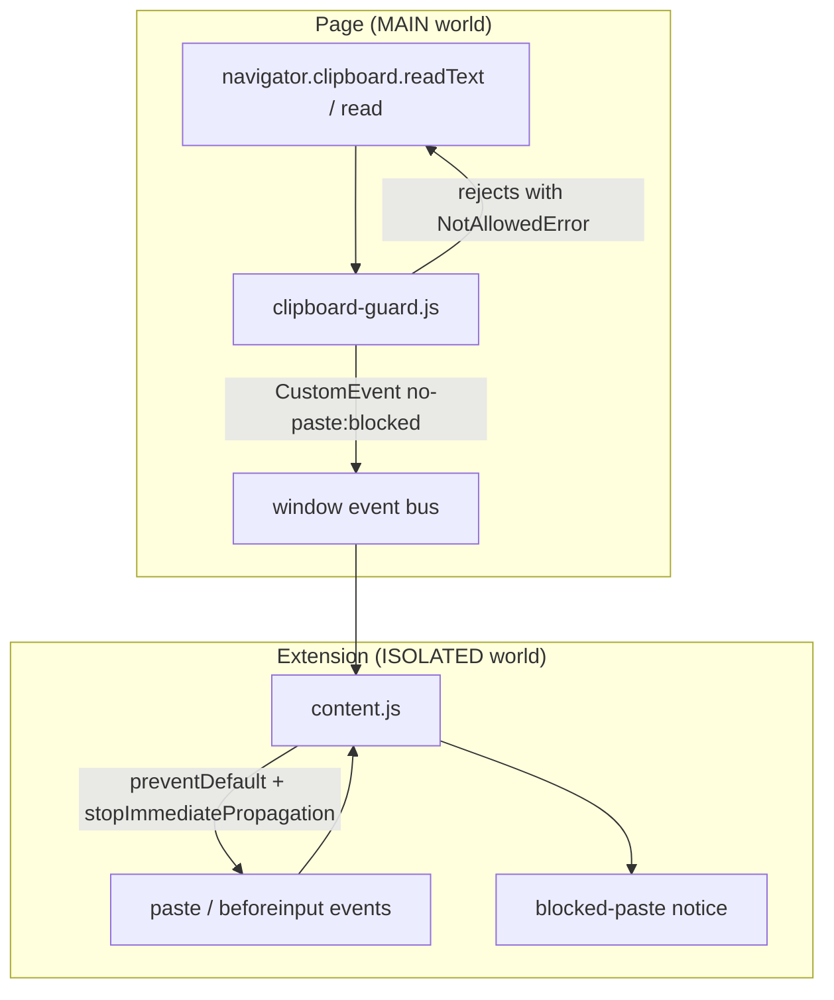

# Architecture

No Paste blocks text paste with two Manifest V3 content scripts that run
side by side in every frame: one in the page's own JavaScript world, one
in Chrome's isolated extension world. They share no globals — the only
channel between them is a DOM `CustomEvent` on `window`.

## `clipboard-guard.js` — MAIN world

Declared first in `manifest.json` with `"world": "MAIN"`, so it executes
inside the page's JavaScript realm at `document_start`, before page
scripts run.

- Replaces `navigator.clipboard.readText` with a function that rejects
  with a `NotAllowedError` `DOMException`.
- Wraps `navigator.clipboard.read` so it still resolves for non-text
  clipboard items, but rejects when any returned `ClipboardItem` carries
  a `text/*` type.
- The guard is defined on the `Clipboard` prototype first; if that fails
  it falls back to the `clipboard` instance itself, and is marked
  non-writable and non-configurable so page code cannot restore the
  original.
- Every rejection dispatches a `no-paste:blocked` `CustomEvent` on
  `window` so the isolated script can show the notice.

This guard is best-effort: a hostile page that captures a reference to
the original methods before `document_start` can bypass it. It raises
the bar for custom paste buttons and is not a security boundary.

## `content.js` — ISOLATED world

Runs in the extension's isolated world at `document_start`. It blocks
the native paste paths the Clipboard API guard cannot reach:

- `paste` events on `window` (capture phase) are cancelled when
  `event.clipboardData.types` contains a `text/*` type.
- `beforeinput` events with `inputType` of `insertFromPaste` or
  `insertFromPasteAsQuotation` are cancelled when they carry string data
  or a `text/*` `dataTransfer` type.
- Non-text paste (images, files) and ordinary typing pass through.

Blocked events get `preventDefault()` plus `stopImmediatePropagation()`
so page listeners never see them. The same handler listens for the
`no-paste:blocked` event from the MAIN-world guard.

## Blocked-paste notice

Both paths funnel into `showBlockedNotice()`, which renders a small
fixed-position "Text paste blocked." banner for 2.5 seconds. The notice
lives in a closed shadow root with `all: initial` on the host so page
styles cannot leak in, and carries `role="status"` /
`aria-live="polite"` so screen readers announce it.

## Coverage

Both scripts use `run_at: "document_start"`, `all_frames: true`,
`match_about_blank: true`, and `match_origin_as_fallback: true`, so
they run in iframes, `about:blank` frames, and `srcdoc`/`data:` frames
where Chrome permits extension access. Chrome still excludes protected
pages (`chrome://`, the Web Store, the PDF viewer) and whatever the user
disables in site-access settings.

## Build and packaging

TypeScript sources compile to IIFE bundles with esbuild targeting
Chrome 111 (`pnpm build`, `scripts/build.ts`), alongside the manifest,
icons, and license in `build/`. `pnpm package` (`scripts/package.ts`)
writes a versioned ZIP to `dist/` using a small dependency-free ZIP
writer (store-only entries, CRC-32 checksums computed in-process) so a
release archive never depends on system zip tooling.
